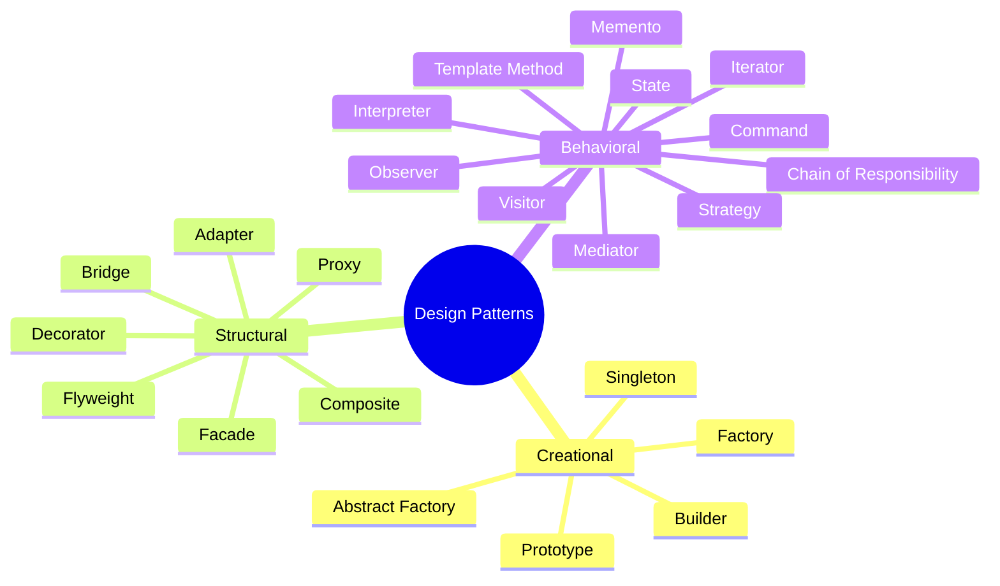

# Design Patterns in Java

A comprehensive collection of the 23 Gang of Four (GoF) design patterns implemented in Java 25 with Maven.

## Reference

These patterns are based on the classic book:

> **"Design Patterns: Elements of Reusable Object-Oriented Software"**
> by Erich Gamma, Richard Helm, Ralph Johnson, and John Vlissides
> Addison-Wesley, 1994

Also known as the "Gang of Four" (GoF) book, it remains the definitive reference for object-oriented design patterns.

## Requirements

- Java 25 (LTS)
- Maven 3.9+

## Overview



## How to run a pattern

Each pattern ships with a `*Demo` class containing a `main` method:

```bash
mvn -q compile exec:java -Dexec.mainClass="com.mattee37.patterns.creational.builder.BuilderDemo"
```

(Replace the main class with the pattern you want to run.)

## Run all tests

```bash
mvn test
```

## Patterns

### Creational Patterns

Deal with object creation mechanisms.

| Pattern | Description | Demo class |
|---------|-------------|------------|
| [Factory](src/main/java/com/mattee37/patterns/creational/factory/README.md) | Create objects without specifying exact class | `creational.factory.FactoryDemo` |
| [Abstract Factory](src/main/java/com/mattee37/patterns/creational/abstractfactory/README.md) | Create families of related objects | `creational.abstractfactory.AbstractFactoryDemo` |
| [Builder](src/main/java/com/mattee37/patterns/creational/builder/README.md) | Construct complex objects step by step | `creational.builder.BuilderDemo` |
| [Prototype](src/main/java/com/mattee37/patterns/creational/prototype/README.md) | Clone existing objects | `creational.prototype.PrototypeDemo` |
| [Singleton](src/main/java/com/mattee37/patterns/creational/singleton/README.md) | Ensure single instance | `creational.singleton.SingletonDemo` |

### Structural Patterns

Deal with object composition and relationships.

| Pattern | Description | Demo class |
|---------|-------------|------------|
| [Adapter](src/main/java/com/mattee37/patterns/structural/adapter/README.md) | Match interfaces of different classes | `structural.adapter.AdapterDemo` |
| [Bridge](src/main/java/com/mattee37/patterns/structural/bridge/README.md) | Separate abstraction from implementation | `structural.bridge.BridgeDemo` |
| [Composite](src/main/java/com/mattee37/patterns/structural/composite/README.md) | Treat groups of objects as single instance | `structural.composite.CompositeDemo` |
| [Decorator](src/main/java/com/mattee37/patterns/structural/decorator/README.md) | Add responsibilities to objects dynamically | `structural.decorator.DecoratorDemo` |
| [Facade](src/main/java/com/mattee37/patterns/structural/facade/README.md) | Simplify interface to complex subsystem | `structural.facade.FacadeDemo` |
| [Flyweight](src/main/java/com/mattee37/patterns/structural/flyweight/README.md) | Minimize memory via shared objects | `structural.flyweight.FlyweightDemo` |
| [Proxy](src/main/java/com/mattee37/patterns/structural/proxy/README.md) | Substitute for a real object | `structural.proxy.ProxyDemo` |

### Behavioral Patterns

Deal with communication between objects.

| Pattern | Description | Demo class |
|---------|-------------|------------|
| [Chain of Responsibility](src/main/java/com/mattee37/patterns/behavioral/chainofresponsibility/README.md) | Pass request along a chain of handlers | `behavioral.chainofresponsibility.ChainOfResponsibilityDemo` |
| [Command](src/main/java/com/mattee37/patterns/behavioral/command/README.md) | Encapsulate a request as an object | `behavioral.command.CommandDemo` |
| [Interpreter](src/main/java/com/mattee37/patterns/behavioral/interpreter/README.md) | Include interpretation of grammar | `behavioral.interpreter.InterpreterDemo` |
| [Iterator](src/main/java/com/mattee37/patterns/behavioral/iterator/README.md) | Access elements of a collection sequentially | `behavioral.iterator.IteratorDemo` |
| [Mediator](src/main/java/com/mattee37/patterns/behavioral/mediator/README.md) | Simplify communication between objects | `behavioral.mediator.MediatorDemo` |
| [Memento](src/main/java/com/mattee37/patterns/behavioral/memento/README.md) | Capture and restore object state | `behavioral.memento.MementoDemo` |
| [Observer](src/main/java/com/mattee37/patterns/behavioral/observer/README.md) | Notify changes to multiple objects | `behavioral.observer.ObserverDemo` |
| [State](src/main/java/com/mattee37/patterns/behavioral/state/README.md) | Alter behavior when internal state changes | `behavioral.state.StateDemo` |
| [Strategy](src/main/java/com/mattee37/patterns/behavioral/strategy/README.md) | Encapsulate interchangeable algorithms | `behavioral.strategy.StrategyDemo` |
| [Template Method](src/main/java/com/mattee37/patterns/behavioral/templatemethod/README.md) | Skeleton of algorithm, subclasses fill steps | `behavioral.templatemethod.TemplateMethodDemo` |
| [Visitor](src/main/java/com/mattee37/patterns/behavioral/visitor/README.md) | Add operations to objects without modifying them | `behavioral.visitor.VisitorDemo` |

## Structure

```
src/main/java/com/mattee37/patterns/
├── creational/    (5 patterns)
├── structural/    (7 patterns)
└── behavioral/    (11 patterns)
```

Each pattern package contains:

- Pattern implementation classes (interfaces + classes)
- `*Demo` — runnable `main` demonstrating the pattern
- `README.md` — explanation with structure and usage example

Tests live under `src/test/java/com/mattee37/patterns/` (one test class per pattern).
