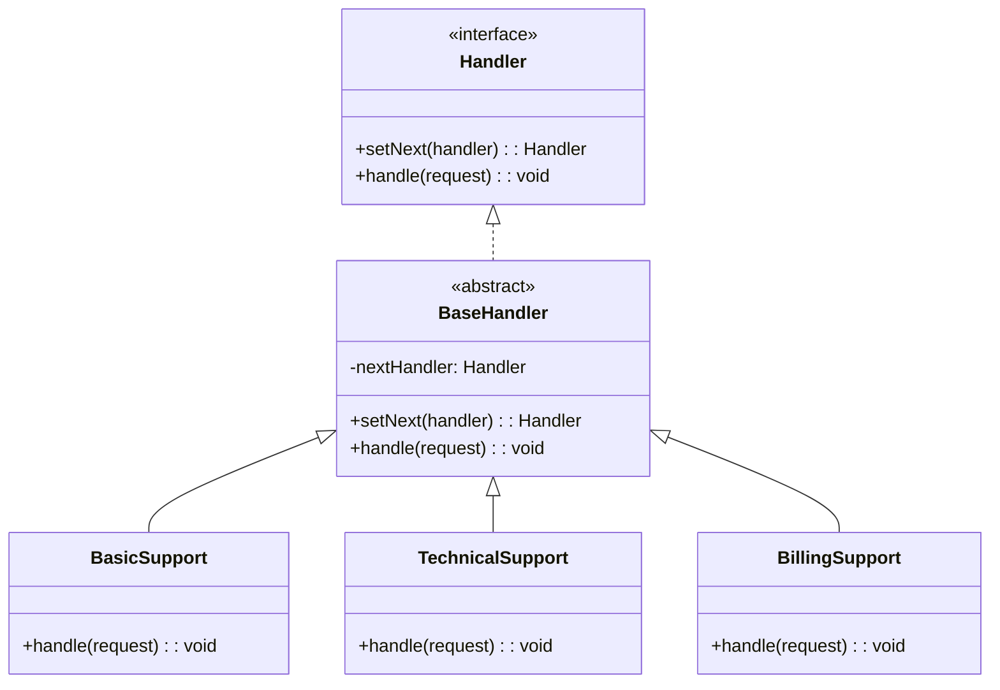
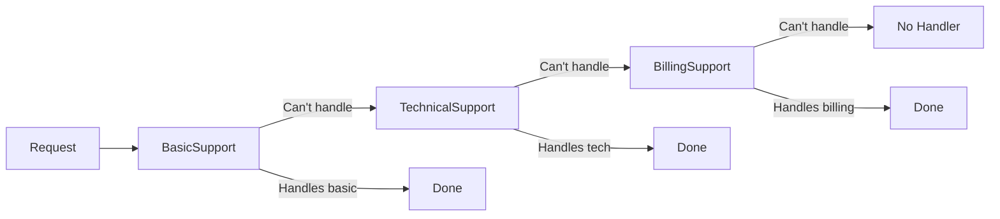
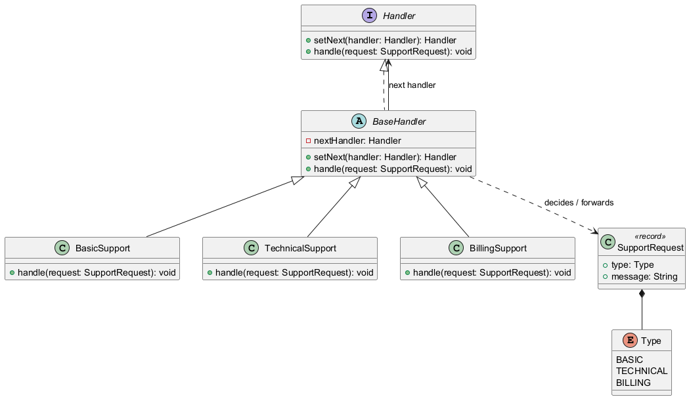
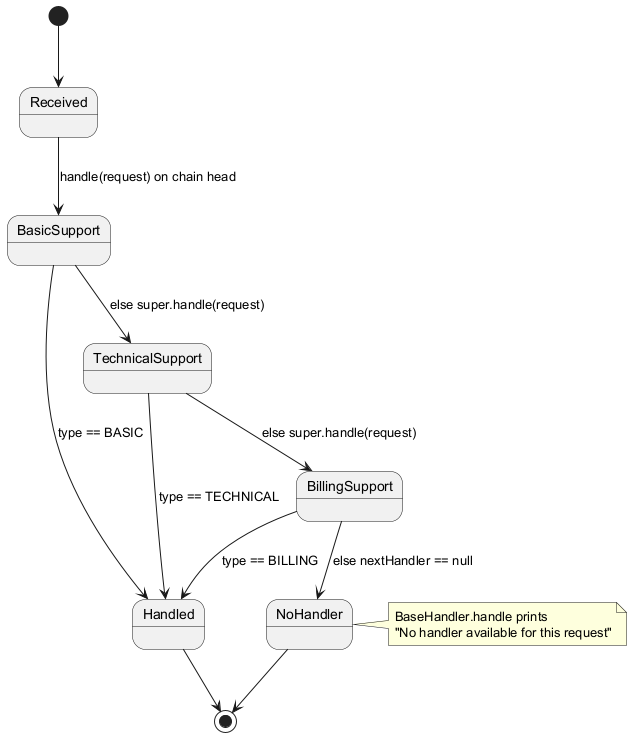
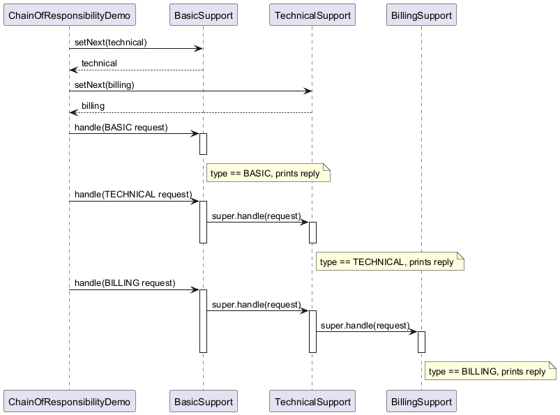
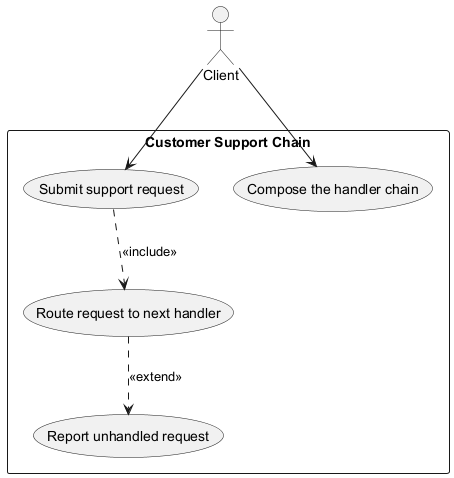

# Chain of Responsibility Pattern

## Intent

Avoid coupling the sender of a request to its receiver by giving more than one object a chance to handle the request. Chain the receiving objects and pass the request along the chain until an object handles it.

## Problem

You have multiple handlers that could process a request, and you want to decouple the sender from the specific handler.

## Solution

Create a chain of handler objects. Each handler decides whether to process the request or pass it to the next handler in the chain.

## Diagram



## Our Example

We implement a customer support system:

- **`SupportRequest.java`**: Record with `Type` enum (`BASIC`, `TECHNICAL`, `BILLING`) and message
- **`Handler.java`**, **`BaseHandler.java`**: Interface and abstract base with the chain link
- **`BasicSupport.java`**, **`TechnicalSupport.java`**, **`BillingSupport.java`**: Concrete handlers
- **`ChainOfResponsibilityDemo.java`**: Builds the chain and processes different requests

## Request Flow



## Chain Setup

```java
BasicSupport basic = new BasicSupport();
TechnicalSupport technical = new TechnicalSupport();
BillingSupport billing = new BillingSupport();

basic.setNext(technical).setNext(billing);
```

## When to Use

- When more than one object may handle a request
- When you want to issue a request without specifying the receiver
- When the set of handlers should be specified dynamically

## Run

```bash
mvn -q compile exec:java -Dexec.mainClass="com.mattee37.patterns.behavioral.chainofresponsibility.ChainOfResponsibilityDemo"
```

## Diagrams

### Class


### State


### Sequence


### Use Case

