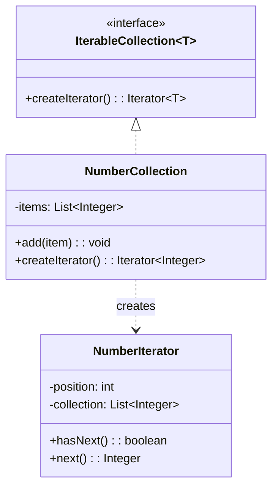
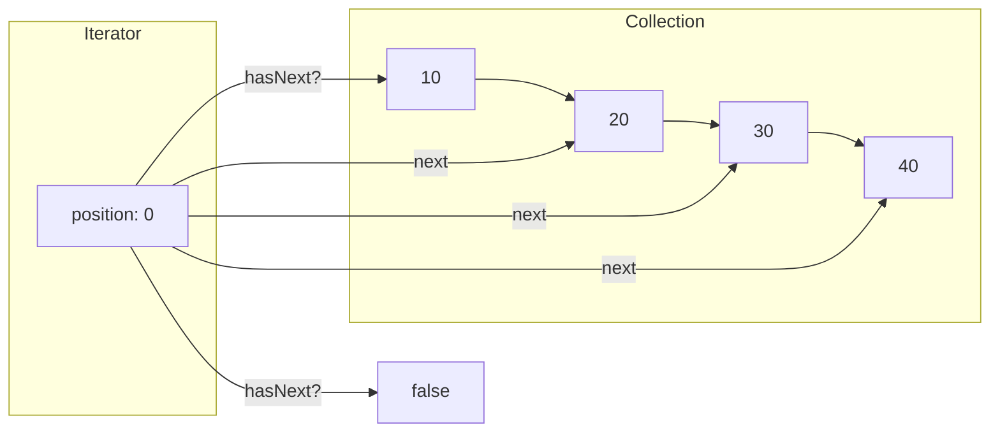

# Iterator Pattern

## Intent

Provide a way to access the elements of an aggregate object sequentially without exposing its underlying representation.

## Problem

You need to traverse a collection without exposing its internal structure, and you may need multiple traversal algorithms.

## Solution

Extract the traversal behavior into a separate iterator object that knows how to access the collection's elements.

## Diagram



## Our Example

We implement a custom number collection with an iterator:

- **`IterableCollection.java`**: The collection interface with `createIterator()`
- **`NumberCollection.java`**: `NumberCollection` and its private `NumberIterator` (both traversal state and iteration live outside the collection's internals)
- **`IteratorDemo.java`**: Demonstrates iteration

## Usage Pattern



## Standard Usage

```java
Iterator<Integer> iterator = collection.createIterator();

while (iterator.hasNext()) {
    System.out.println(iterator.next());
}
```

## Note

The Java port reuses `java.util.Iterator` (`hasNext()` / `next()`), whose contract is identical to the custom `Iterator<T>` interface in the TypeScript version, instead of re-declaring it. The custom structure the example shows — a collection that hands out a separate iterator object — is preserved.

## When to Use

- When you want to access a collection's contents without exposing its internal structure
- When you need multiple traversal methods for a collection
- When you want a uniform interface for traversing different collections

## Run

```bash
mvn -q compile exec:java -Dexec.mainClass="com.mattee37.patterns.behavioral.iterator.IteratorDemo"
```
