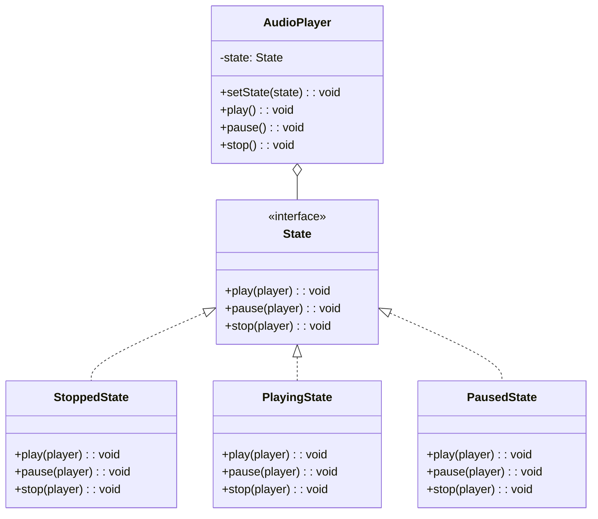
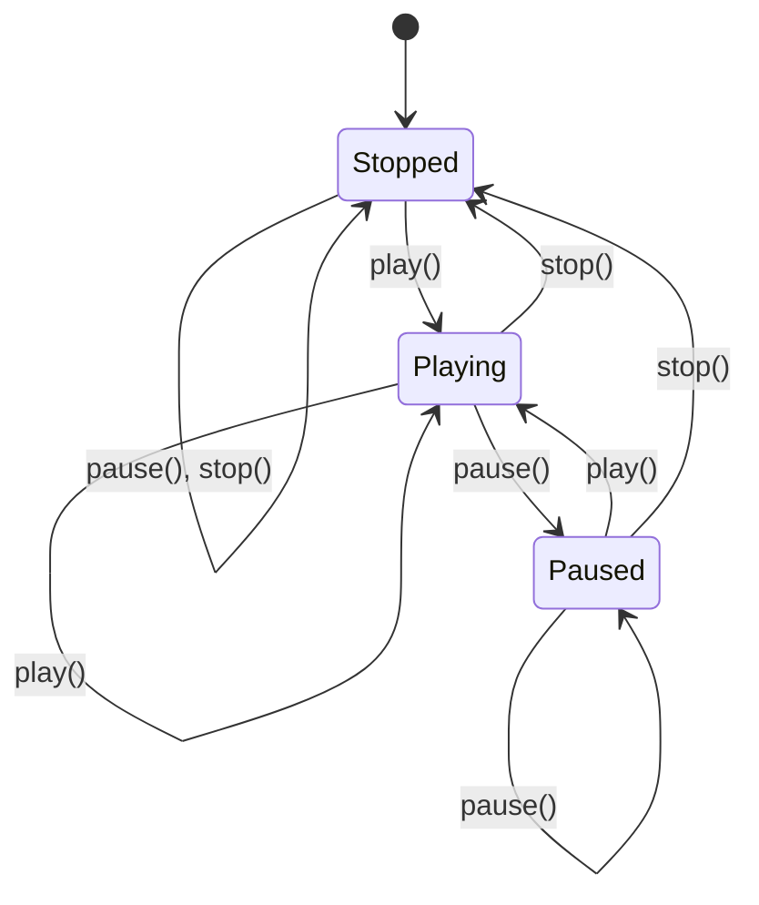
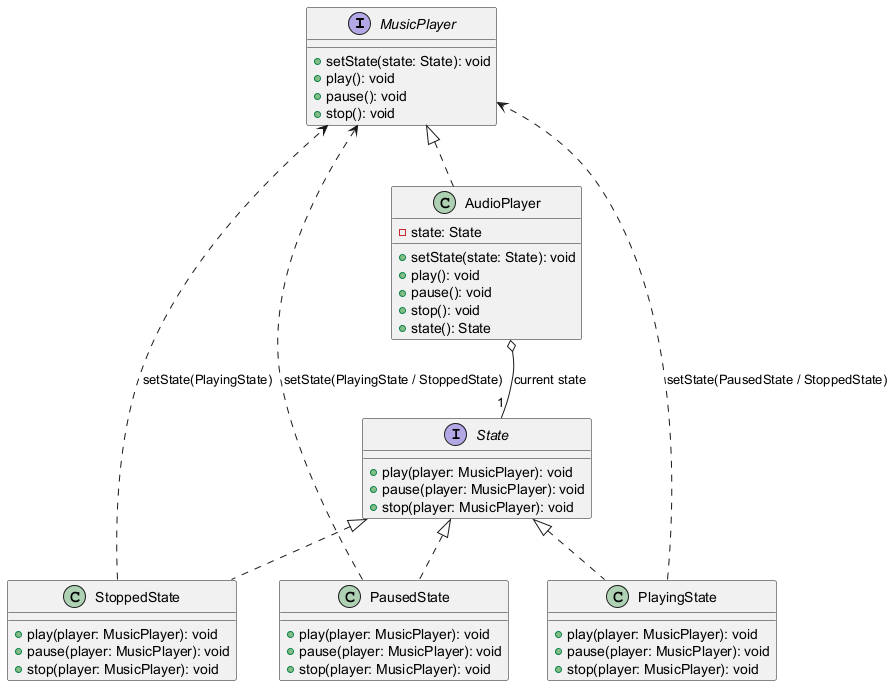
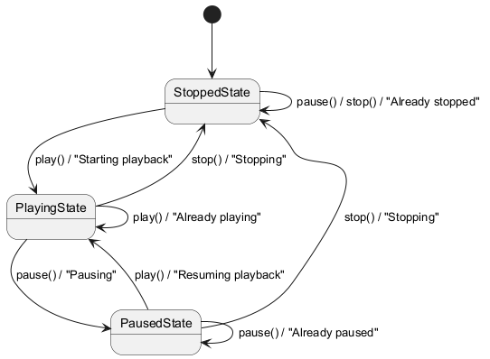
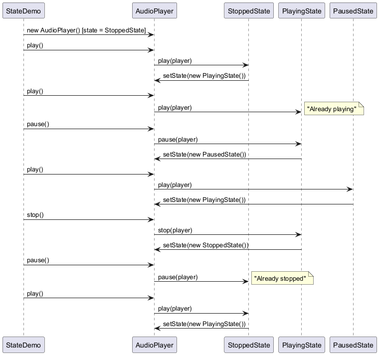
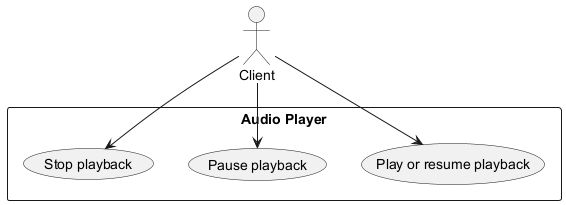

# State Pattern

## Intent

Allow an object to alter its behavior when its internal state changes. The object will appear to change its class.

## Problem

An object's behavior depends on its state, and you have complex conditional logic based on state.

## Solution

Encapsulate state-specific behavior into separate state classes and delegate to the current state object.

## Diagram



## Our Example

We implement a music player with states:

- **`State.java`** / **`MusicPlayer.java`**: `State` and `MusicPlayer` interfaces
- **`StoppedState.java`**, **`PlayingState.java`**, **`PausedState.java`**: state classes
- **`AudioPlayer.java`**: context that delegates to the current state
- **`StateDemo.java`**: Demonstrates state transitions

## State Transitions



## State vs Conditionals

```java
// ❌ Without State Pattern
public void play() {
    if (state.equals("stopped")) {
        state = "playing";
    } else if (state.equals("paused")) {
        state = "playing";
    }
    // More conditions...
}

// ✅ With State Pattern
public void play() {
    state.play(this);
}
```

## When to Use

- When object behavior depends on its state and changes at runtime
- When you have large conditional statements based on object state
- When you have duplicate code across state-dependent operations

## Run

```bash
mvn -q compile exec:java -Dexec.mainClass=com.mattee37.patterns.behavioral.state.StateDemo
```

## Diagrams

### Class


### State


### Sequence


### Use Case

