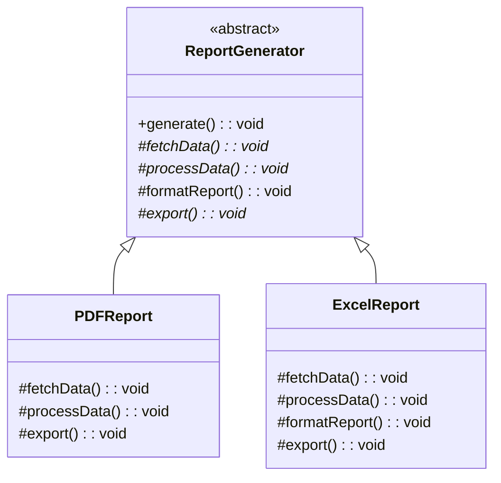
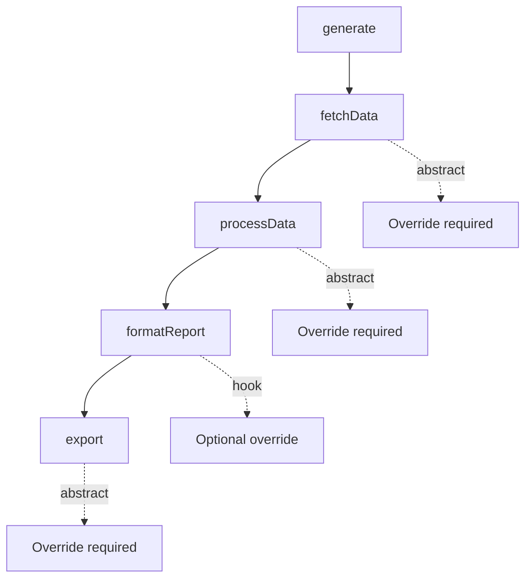
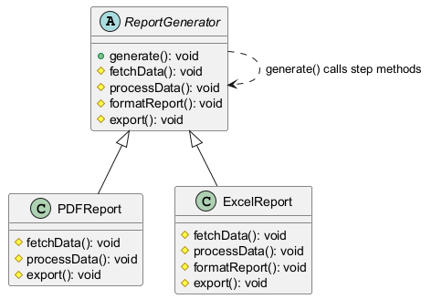
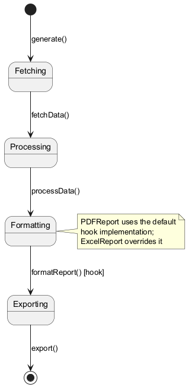
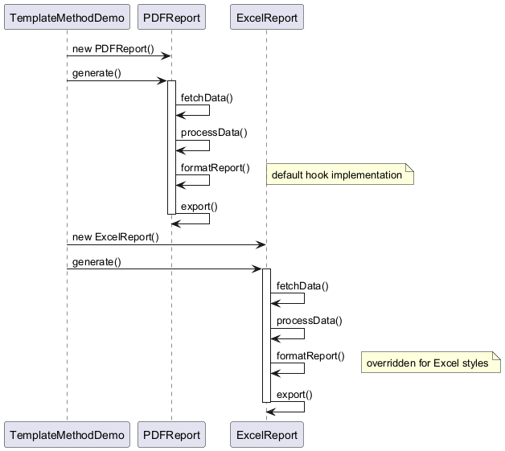
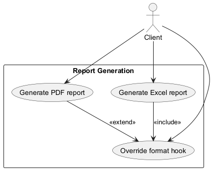

# Template Method Pattern

## Intent

Define the skeleton of an algorithm in an operation, deferring some steps to subclasses. Template Method lets subclasses redefine certain steps of an algorithm without changing the algorithm's structure.

## Problem

You have algorithms with similar structures but different implementations for certain steps.

## Solution

Define the algorithm structure in a base class method that calls abstract methods, which subclasses override.

## Diagram



## Our Example

We implement a report generation system:

- **`ReportGenerator.java`**: Abstract class with template method `generate()`
- **`PDFReport.java`** and **`ExcelReport.java`**: implementations
- **`TemplateMethodDemo.java`**: Generates both report types

## Algorithm Template



## Template Method Structure

```java
public abstract class ReportGenerator {
    // Template method - defines algorithm structure
    public void generate() {
        fetchData();      // Step 1
        processData();    // Step 2
        formatReport();   // Step 3 (hook with default)
        export();         // Step 4
    }

    protected abstract void fetchData();
    protected abstract void processData();
    protected void formatReport() { /* default */ }
    protected abstract void export();
}
```

## Hook Methods

`formatReport()` is a hook—it has a default implementation but can be overridden:
- `PDFReport`: Uses default formatting
- `ExcelReport`: Overrides with Excel-specific styles

## When to Use

- When you have algorithms with similar structures
- When you want to let clients extend specific steps without modifying structure
- When you have code duplication across similar algorithms

## Run

```bash
mvn -q compile exec:java -Dexec.mainClass=com.mattee37.patterns.behavioral.templatemethod.TemplateMethodDemo
```

## Diagrams

### Class


### State


### Sequence


### Use Case

