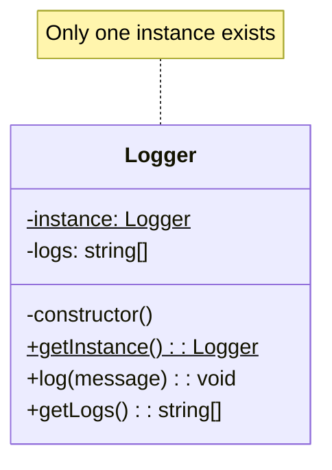
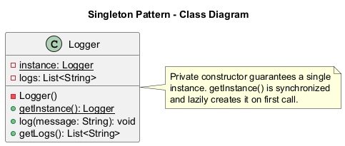
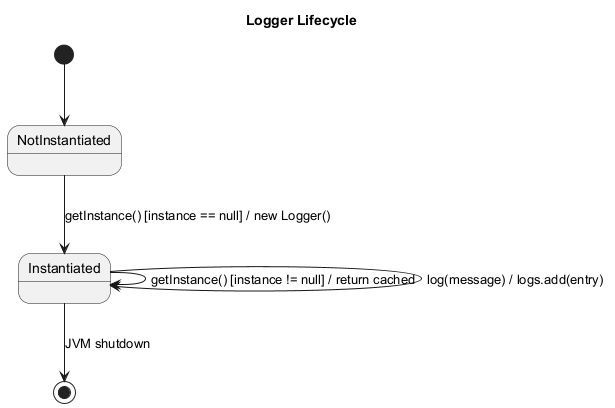
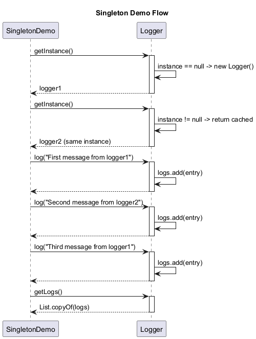
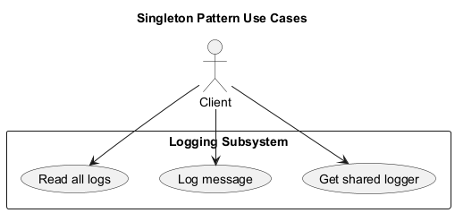

# Singleton Pattern

## Intent

Ensure a class has only one instance and provide a global point of access to it.

## Problem

You need exactly one instance of a class, and it must be accessible from a well-known access point.

## Solution

Make the constructor private and provide a static method that returns the same instance every time it's called.

## Diagram



## Our Example

We implement a Logger singleton:

- **`Logger.java`**: Implements `Logger` class with private constructor and `getInstance()` static method
- **`SingletonDemo.java`**: Demonstrates that multiple calls return the same instance

## Key Implementation

```java
public class Logger {
    private static Logger instance;

    private Logger() {} // Private!

    public static synchronized Logger getInstance() {
        if (instance == null) {
            instance = new Logger();
        }
        return instance;
    }
}
```

## Verification

```java
Logger logger1 = Logger.getInstance();
Logger logger2 = Logger.getInstance();
System.out.println(logger1 == logger2); // true
```

## When to Use

- When exactly one instance of a class is needed
- For shared resources like database connections, loggers, or configuration
- When you need stricter control over global variables

## Caution

Singleton is often considered an anti-pattern because it:
- Makes unit testing harder
- Introduces global state
- Violates single responsibility principle

Consider dependency injection as an alternative.

## Run

Run `com.mattee37.patterns.creational.singleton.SingletonDemo#main`.

## Diagrams

### Class


### State


### Sequence


### Use Case

